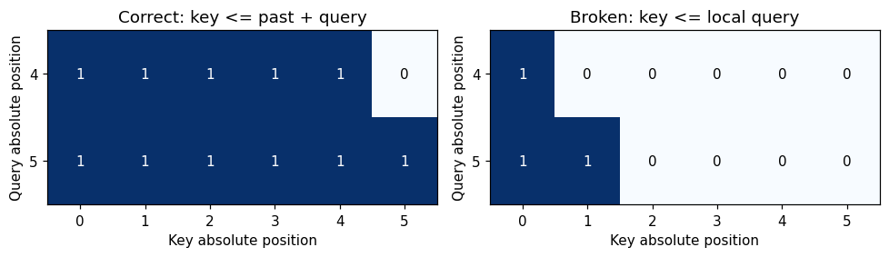
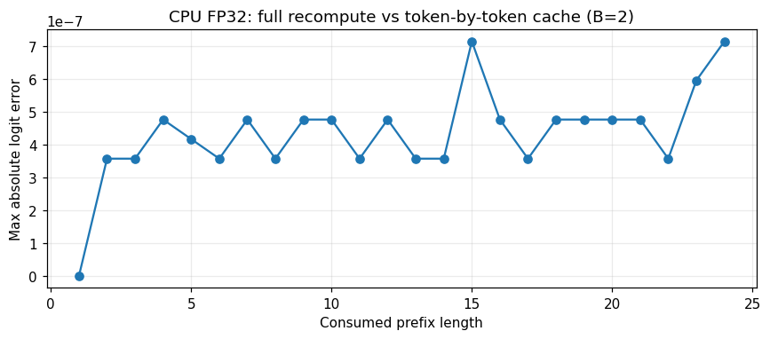
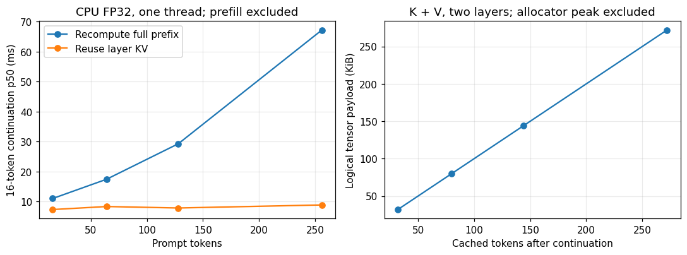

## The idea in 30 seconds

A KV cache retains the keys and values already computed at each attention layer. When new tokens arrive, compute their projections and hidden states, then let their queries read the historical K/V. Earlier tokens still participate in attention; they no longer need to pass through the entire network again.

Three conventions must agree: **which layer owns each cache, the absolute positions of the new tokens, and the keys each query may read**. We implement these conventions in an untrained, 145,280-parameter, two-layer decoder. Assertions check the implementation, and deliberately broken versions establish that the checks can detect errors.

Start with sections 5–6 of the embedded browser notebook for masks and single-head attention. Switch to “Full PyTorch experiment & saved outputs” for the complete decoder in sections 5–9. Its weights are randomly initialized locally; no pretrained model download is required.

## The gap after serving and profiling

The [serving chapter](/blog/llm-infra-serving-en) explains prefill, decode, queues and memory budgets. The [profiling chapter](/blog/llm-infra-profiling-en) explains warm-up, measurement boundaries and falsifiable performance hypotheses. A remaining implementation question is: how can a multilayer Transformer produce the same answer when only the newest token enters the network?

Hold the token stream, parameters and precision fixed. One execution path recomputes the complete prefix at each step. The other keeps a separate K/V cache at every layer and processes only the new positions. Establish equivalence before discussing time.

Random weights suffice for this question. We are checking two executions of the same mathematical function, rather than testing whether the model can write meaningful language.

## A six-token example

Consider token IDs `[12, 7, 31, 4, 9, 18]`. Prefill has consumed the first four tokens. The next call receives the remaining two together.

| Object | Positions or shape | Meaning |
| --- | --- | --- |
| Existing cache | Absolute positions 0, 1, 2, 3 | One K/V pair per layer |
| New input | IDs 9, 18 at positions 4, 5 | Only these positions pass through the new forward call |
| Current Q | `[B, H, 2, Dh]` | Queries for positions 4 and 5 |
| Concatenated K/V | Each `[B, H, 6, Dh]` | Four historical and two current positions |
| Attention scores | `[B, H, 2, 6]` | Two queries reading six keys |
| Returned logits | `[B, 2, Vocab]` | A next-token distribution after each consumed position |

Query 4 may read keys 0–4; query 5 may read keys 0–5. Sharing a forward call does not allow the first new position to read the second one.

The first returned logit vector predicts what follows ID 9. It is not the probability of ID 9 itself. Comparing cached and uncached results requires aligning the same consumed position, without a one-token shift.

## Why every layer needs its own cache

At layer $\ell$, normalize the layer input and project it (projection biases omitted in this notation):

$$
Q_\ell=\mathrm{LN}(X_\ell)W_\ell^Q,\quad
K_\ell=\mathrm{LN}(X_\ell)W_\ell^K,\quad
V_\ell=\mathrm{LN}(X_\ell)W_\ell^V.
$$

Attention, residual connections and the MLP turn this input into the next layer's input. Layer 2 therefore needs keys and values derived from its own representations; layer 1's K/V are not interchangeable with them. The cache is an ordered collection of `(K, V)` pairs, indexed by layer.

Why do historical representations remain reusable? Causal attention makes position $i$ depend only on positions $0\ldots i$. With fixed parameters and positions, and stochastic dropout disabled, appending future tokens leaves old first-layer outputs unchanged. Apply the same argument at the next layer and continue by induction.

Changing historical tokens, model weights or positional rules can invalidate the cache. Sharing prefixes across requests requires checking all conditions that affect their representations, not just matching a convenient tensor shape.

## Derive the mask from absolute positions

Let the cache contain $P$ positions and the new chunk contain $C$ tokens. Local query index $i$ corresponds to absolute position $P+i$. Keys span indices $0\ldots P+C-1$, so visibility is:

$$
\mathrm{allowed}_{i,j}=[j\le P+i].
$$

```python
query_pos = past_len + torch.arange(new_len)
key_pos = torch.arange(past_len + new_len)
allowed = key_pos[None, :] <= query_pos[:, None]
scores = (q @ k.transpose(-2, -1)) / math.sqrt(head_dim)
weights = scores.masked_fill(~allowed, -torch.inf).softmax(-1)
```



An ordinary upper-left triangle over `[C, P+C]` treats local query 0 as absolute position 0. For a single new token it may expose only the first key. Every tensor shape remains legal, and the code runs, while its output changes.

PyTorch's SDPA documentation describes upper-left causal alignment for non-square matrices. Check the mask semantics of the version you use when switching to `scaled_dot_product_attention`. Here we construct the offset mask explicitly. A single new query may see every key if K/V contain only past and current positions; a multi-token chunk must still prevent access to future positions inside that chunk.

Position embeddings need the same offset. This model uses learned absolute positions: the next call starts at $P$. Restarting at zero makes the new tokens look like the beginning of the sequence. RoPE encodes positions through Q/K rotations and likewise requires a consistent position convention, but is outside this implementation.

## The complete decoder path

`CacheDecoder` contains token and position embeddings, two pre-norm blocks, a final LayerNorm and vocabulary projection. Each block applies the attention residual, followed by the MLP residual. Width is 64, heads 4, head dimension 16, vocabulary 97 and MLP hidden width 256.

```python
# Cache entry ell belongs to layer ell. Historical tensors are immutable.
k = torch.cat((past_k, new_k), dim=-2)
v = torch.cat((past_v, new_v), dim=-2)
context = (weights @ v).transpose(1, 2).reshape(batch, new_len, width)
x = x + attention_output(context)
x = x + mlp(layer_norm(x))
```

This excerpt shows the key path. **Notebook sections 5–9 contain the complete executable classes and checks.** Dynamic `torch.cat` makes the logic inspectable, while allocating tensors and copying historical data. Those costs are included in the timing. Preallocated or paged caches and fused kernels use different storage and execution strategies and need their own validation.

## Establishing equivalence

Matching argmax is a weak check: substantially different logits can select the same token. We compare every vocabulary logit at every position, as well as each layer's K/V.

| Dimension | Executed coverage |
| --- | --- |
| Batch size | 1 and 2 |
| Input chunks | 1, 2 and 5 tokens; final chunks may be shorter |
| Precision | CPU FP32 and CPU FP64 |
| Position alignment | All 24 consumed positions |
| Internal states | Both layers' K/V values and `[B, 4, T, 16]` shapes |
| Causality | Changing the last token preserves earlier logits |
| Cache lifecycle | Incremental calls leave input cache tensors unchanged |

FP32 uses `atol=rtol=1e-5`; FP64 uses `1e-10`. Different matrix shapes can change floating-point operation ordering, so comparisons use absolute and relative tolerances rather than requiring bitwise equality. The double-precision check converts the same initialized weights to FP64 and reruns the computation.

Across the 12 configurations, the largest absolute logit error was **8.34e-07** in FP32 and **1.55e-15** in FP64. These executed configurations pass; padding, GQA and other positional schemes require corresponding additional cases.



Negative controls matter too. With the same four-token prefix and two-token continuation, resetting positions produces a maximum logit error of **1.894**. Removing the mask offset produces **0.394**. Both clearly exceed the correct implementation's rounding error and would fail its equivalence assertions.

## What caching removes, and what remains

Fix the number of layers and heads; let hidden width be $D$ and current total length $T$. Full-prefix recomputation runs projections and MLPs on every position, with principal linear-layer work growing as $TD^2$. Naive dense attention scoring and value aggregation grow as $T^2D$.

Single-token cached decode performs projections and MLP work for one new position, roughly $D^2$. Its query still reads the historical K/V, with attention work growing as $TD$. **Caching removes repeated computation of old positions; historical context still has to be read.** This implementation also copies cache data during dynamic concatenation.

After prefill, consuming $G$ additional fixed tokens makes the full path project this many positions per layer:

$$
\sum_{j=1}^{G}(P+j)=GP+\frac{G(G+1)}{2}.
$$

The cached path projects $G$ new positions. For $P=256,G=16$, the counts are 4,232 versus 16. Their ratio is not a latency prediction: matrix efficiency, memory access, dispatch and Python overhead differ between paths.

Logical cache payload is:

$$
M_{KV}=2\,B\,T\,L\,H_{kv}\,D_h\,s.
$$

Our MHA decoder has four KV heads, two layers and four bytes per FP32 element. At batch 1 and final length 272, the payload is 278,528 bytes, or 272 KiB. The notebook checks this against actual `numel()*element_size()` sums. Parameters, attention scores, temporary concatenation tensors, allocator overhead and Python objects are excluded; this is not process peak memory.

## An inspectable CPU measurement

The authoring run used an AMD EPYC 9V74, Python 3.12.14 and PyTorch 2.15.0+cpu. The KV experiment fixes one CPU thread, FP32, `eval()` and `torch.inference_mode()`. Each path receives three warm-ups and 15 measurements, rotating the measurement order of prefill, full recomputation and cached continuation.

Prefill consumes $P$ tokens in a separate window. Both continuation paths then consume the same 16 predetermined tokens and return logits after each one. Cached continuation starts with an existing prefix cache: **its time excludes prefill**. Full recomputation processes the complete current prefix on every step. Tokenization, sampling, network traffic, queues and EOS handling are outside these windows. Our full path projects every prefix position to vocabulary logits before selecting the last one; an optimized implementation can project only the last position. This is an inspectable naive baseline.

| Prompt tokens | Prefill p50 ms | Full continuation p50 / p95 ms | Cached continuation p50 / p95 ms | Final K/V KiB |
| --- | --- | --- | --- | --- |
| 16 | 0.566 | 10.999 / 11.497 | 7.315 / 9.213 | 32 |
| 64 | 1.009 | 17.421 / 18.730 | 8.319 / 9.483 | 80 |
| 128 | 1.703 | 29.274 / 50.737 | 7.832 / 9.263 | 144 |
| 256 | 4.277 | 67.231 / 80.479 | 8.846 / 11.006 | 272 |

Continuation columns cover all 16 steps. The p95 values are empirical quantiles of 15 samples, useful for noticing variability but insufficient for estimating a service tail. The [result JSON](/learning/kv-cache-results.json) retains raw samples, timestamps, configuration and correctness results.



In this run, recomputation time rises more visibly with prefix length. Cached queries still read growing K/V, while fixed overhead matters substantially for this small model. These measurements do not establish GPU speedups, client TTFT/ITL or relative vLLM/SGLang performance. Production kernels, storage layouts and schedulers need measurements on their actual hardware and workloads.

## Run and modify the experiment

The embedded browser notebook's fifth cell exposes history and chunk lengths; its sixth cell reuses a single head's K/V. In the full PyTorch edition, section 5 defines the decoder, section 6 checks equivalence, section 7 breaks positions and masks, and sections 8–9 time execution and save raw results.

- [Open the complete English notebook in Colab](https://colab.research.google.com/github/chenhuiyu/chenhuiyu.github.io/blob/source/public/notebooks/infra-benchmark-en.ipynb)
- [Download the complete notebook](/notebooks/infra-benchmark-en.ipynb)
- [Download this run's results](/learning/kv-cache-results.json)

To regenerate and execute from the blog source checkout:

```bash
python -m pip install torch==2.15.0 --index-url https://download.pytorch.org/whl/cpu
python -m pip install nbformat numpy matplotlib
python scripts/build-learning-notebooks.py --only infra-benchmark --execute
```

Changing width or head count also requires updating the shape assertions and payload formula; width must remain divisible by heads. Changing benchmark prefix lengths requires a sufficiently long fixed token stream within the 512-position limit. Inspect correctness before interpreting time.

**Exercise:** A cache contains 10 tokens and the next chunk has 3. What are the new absolute query positions, the last two score dimensions, and the number of keys visible to the last query?

<details><summary>Reveal the answer</summary>Positions are 10, 11 and 12; scores end in [3, 13]. The queries may read 11, 12 and 13 keys respectively. A triangle based only on local query indices would incorrectly expose 1, 2 and 3 keys.</details>

**Next experiment:** Change the initial prefill length to 1, 4 or 8 and consume the remaining tokens one at a time, comparing each call with full-prefix recomputation. Then consider padding, explicitly separating causal visibility from padding visibility.

## Primary references

- [Hugging Face Transformers 4.57.1: Caching](https://huggingface.co/docs/transformers/v4.57.1/cache_explanation): per-layer caches, mask lengths and cache positions.
- [PyTorch 2.15: scaled_dot_product_attention](https://docs.pytorch.org/docs/2.15/generated/torch.nn.functional.scaled_dot_product_attention.html): mask, dropout and non-square causal alignment semantics.
- [Experiment generator](https://github.com/chenhuiyu/chenhuiyu.github.io/blob/source/scripts/build-learning-notebooks.py): complete model, assertions, timing protocol and bilingual notebook outputs.

References checked and experiment executed on 2026-11-02. Scope: an untrained MHA decoder with learned absolute positions. Padding, GQA, RoPE, sliding windows, quantized caches and serving schedulers are not implemented here.
