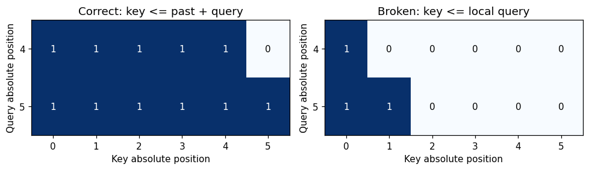
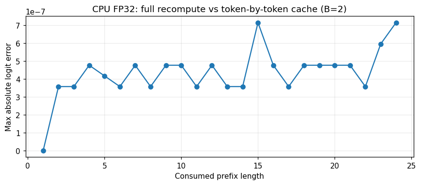
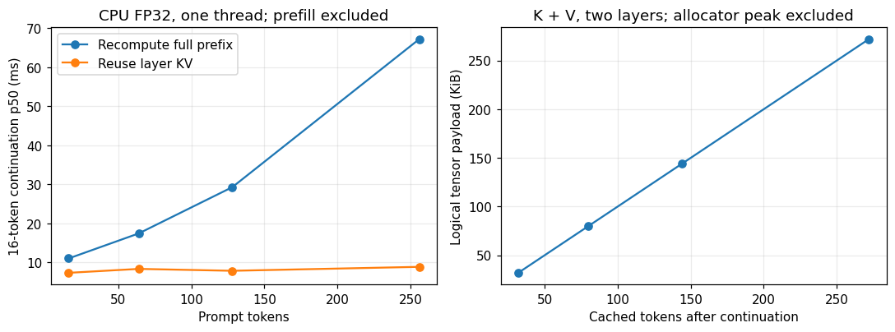

## 30 秒看懂本文

KV cache 保存每一层已经计算过的 key 和 value。下一次输入新 token 时，只计算新位置的投影和隐藏状态，再让新 query 读取历史 K/V。过去的 token 仍然参与 attention，只是不用再通过整套网络重算。

实现时有三个约定必须一致：**每层的 cache 对应哪一层、当前 token 的绝对位置、query 可以看到哪些 key**。本文用一个 145,280 参数、未训练的两层 Decoder，把这些约定落实为可以失败的断言，再用两个错误实现验证测试确实能发现问题。

你可以先运行文末浏览器 Notebook 的第 5–6 节，观察 mask 和单头注意力；再切换到「完整 PyTorch 实验与已有输出」，阅读和下载第 5–9 节的完整 Decoder。所有模型权重都在本地随机初始化，实验不需要下载预训练模型。

## 前文留下的一个缺口

[推理服务一章](/blog/llm-infra-serving-zh)建立了 prefill、decode、排队和显存的账本；[profiling 一章](/blog/llm-infra-profiling-zh)介绍了预热、计时边界和可证伪的性能解释。它们还没有回答一个实现问题：如果只把最后一个 token 送进网络，多层 Transformer 怎么得到与完整前缀相同的结果？

先把服务调度放到一边。我们固定输入 token、模型参数和计算精度，让两条执行路径处理同一段数据。一条每次重算完整前缀，另一条保留每层 K/V，只处理新位置。先证明它们输出一致，再讨论运行时间。

这里的模型没有语言能力。未训练权重足以检查缓存的计算等价性，因为这项检查关心同一个函数的两种执行方式，而不是模型能否写出通顺的句子。

## 一个六个 token 的例子

假设 token ID 是 `[12, 7, 31, 4, 9, 18]`。前四个位置已完成 prefill，接下来一次输入最后两个 token。

| 对象 | 位置或 shape | 作用 |
| --- | --- | --- |
| 旧 cache | 绝对位置 0、1、2、3 | 每层各有一份 K 和 V |
| 本次输入 | ID 9、18，位置 4、5 | 只嵌入、计算这两个新位置 |
| 当前 Q | `[B, H, 2, Dh]` | 分别为位置 4、5 发起查询 |
| 拼接后的 K/V | 各 `[B, H, 6, Dh]` | 历史四个位置加当前两个位置 |
| attention scores | `[B, H, 2, 6]` | 两个 query 对六个 key 的打分 |
| 返回 logits | `[B, 2, Vocab]` | 每个位置预测其后一个 token 的分布 |

位置 4 的 query 可以读取 key 0–4，位置 5 可以读取 key 0–5。第一个新位置不能看到第二个新位置，虽然这两个 token 在同一次函数调用中输入。

`logits[:, 0]` 是消费 ID 9 后得到的下一 token 预测；它不是“ID 9 的概率”。缓存和完整重算要对齐的是同一个被消费位置，比较错一格也会制造看似合理的误差。

## 为什么需要每层单独缓存

对于第  $\ell$  层，先对该层输入做归一化，再投影。下面的记号省略投影偏置：

$$
Q_\ell=\mathrm{LN}(X_\ell)W_\ell^Q,\quad
K_\ell=\mathrm{LN}(X_\ell)W_\ell^K,\quad
V_\ell=\mathrm{LN}(X_\ell)W_\ell^V.
$$

一层输出经过残差和 MLP，成为下一层输入。第二层的 K/V 来自第二层的输入表示，不能拿第一层的 K/V 代替。因此，cache 的外层结构是按层排列的 `(K, V)` 对。

为什么旧表示可以保留？因果 attention 让位置  $i$  的表示只依赖位置  $0\ldots i$ 。在模型参数和绝对位置固定、关闭随机 dropout 的条件下，追加未来 token 不会改变旧位置第一层的输出；对第二层应用相同论证，旧表示也保持不变。按层递推，就得到多层缓存可复用的理由。

这个理由也说明了边界：如果改了历史 token、模型参数或位置规则，需要重新计算受影响的缓存。跨请求共享前缀还需要验证模型、输入、位置和其他影响表示的条件一致。

## 从 shape 写到正确的 mask

设 cache 已有  $P$  个位置，本次输入  $C$  个新 token。局部 query 下标  $i$  对应绝对位置  $P+i$ ；key 下标  $j$  覆盖  $0\ldots P+C-1$ 。允许读取的条件是：

$$
\mathrm{allowed}_{i,j}=[j\le P+i].
$$

对应的核心代码是：

```python
query_pos = past_len + torch.arange(new_len)
key_pos = torch.arange(past_len + new_len)
allowed = key_pos[None, :] <= query_pos[:, None]
scores = (q @ k.transpose(-2, -1)) / math.sqrt(head_dim)
weights = scores.masked_fill(~allowed, -torch.inf).softmax(-1)
```



如果直接对 `[C, P+C]` 矩阵做普通左上角下三角 mask，局部下标 0 会被当成绝对位置 0。特别是 `C=1` 时，新 query 可能只能看到第一个 key。shape 完全合法，程序也能运行，结果却已经变了。

PyTorch 的 SDPA 文档明确区分了非方阵情况下的左上角因果对齐。改用 `scaled_dot_product_attention` 时，应核对所用版本的 mask 语义；本实验显式构造偏移 mask，以便直接检查每一项。单 token decode 若 K/V 只含过去和当前位置，所有这些 key 都可见；多 token chunk 仍需阻止 chunk 内的未来访问。

位置 embedding 同样需要偏移。本例使用 learned absolute positions，第二次调用必须从位置  $P$  开始。每次都从 0 开始，会把新 token 当成句首。RoPE 把位置信息放进旋转后的 Q/K，迁移实现时也要保持位置约定，但本文没有实现 RoPE。

## 完整 Decoder 的计算路径

Notebook 的 `CacheDecoder` 包含 token embedding、位置 embedding、两层 pre-norm block、最终 LayerNorm 和词表投影。每层执行 attention 残差，再执行 MLP 残差。配置固定为 width 64、4 heads、head dimension 16、词表 97、MLP 隐层 256。

```python
# cache 的第 ell 项属于第 ell 层；历史 cache 不被原地修改。
k = torch.cat((past_k, new_k), dim=-2)
v = torch.cat((past_v, new_v), dim=-2)
context = (weights @ v).transpose(1, 2).reshape(batch, new_len, width)
x = x + attention_output(context)
x = x + mlp(layer_norm(x))
```

这里只展示关键路径，**完整可执行类和检查在 Notebook 第 5–9 节**。动态 `torch.cat` 便于阅读，也会分配新 tensor 并复制旧数据。这些开销包含在后面的计时中。预分配、分页 cache 和融合 kernel 可以采用不同的存储与执行方式，需要各自验证。

## 怎样证明输出一致

只比较最后的 argmax 不够：两组 logits 可以差很多，但最大值仍落在同一个 token 上。我们的主检查覆盖每个位置、整个词表的 logits，同时比较每层 K/V。

| 检查维度 | 本次执行的范围 |
| --- | --- |
| 批大小 | 1、2 |
| 输入方式 | 每次 1、2、5 个 token，最后一个 chunk 可不足整块 |
| 精度 | CPU FP32、CPU FP64 |
| 对齐位置 | 全部 24 个消费位置 |
| 中间状态 | 两层 K/V 的内容与 `[B, 4, T, 16]` shape |
| 因果性 | 改最后一个 token，前面位置的 logits 保持一致 |
| cache 生命周期 | 增量调用后，传入的旧 cache 内容保持不变 |

FP32 使用 `atol=rtol=1e-5`，FP64 使用 `1e-10`。浮点加法顺序可能随矩阵 shape 改变，因此检查采用绝对与相对容差，而不是要求逐位相等。FP64 是把相同随机初始化参数转换为 double 后重算，用来区分计算流程错误与舍入差异。

本次 12 组组合中，FP32 最大绝对 logit 误差为 **8.34e-07**，FP64 为 **1.55e-15**。这说明这些已执行输入和配置通过了检查；扩展 padding、GQA 或其他位置编码时，要补相应输入与断言。



还要验证测试能发现错误。保持同一个四 token 前缀和两 token 后缀，分别故意重置位置、取消 mask 的位置偏移。得到的最大 logit 误差分别为 **1.894** 和 **0.394**，远大于正确实现的浮点误差。这两个反例会让等价性检查失败。

## 缓存省下什么，又留下什么

固定层数和 head 数，设隐藏维度为  $D$ 、当前总长度为  $T$ 。完整重算让所有位置再次经过投影和 MLP，其主要线性层计算随  $TD^2$  增长；朴素 dense attention 的打分和加权计算随  $T^2D$  增长。

单 token cache decode 只让新位置经过投影和 MLP，相关计算约为  $D^2$ ；新 query 仍需读取整个历史 K/V，attention 相关计算约为  $TD$ 。**缓存去掉的是旧位置的重复计算，历史上下文的读取仍然存在。** 本例的动态拼接还增加了 cache 复制成本。

在 prefill 已完成后，接着消费  $G$  个固定 token，完整重算每层经过投影的位置数为：

$$
\sum_{j=1}^{G}(P+j)=GP+\frac{G(G+1)}{2}.
$$

缓存路径只投影  $G$  个新位置。例如  $P=256,G=16$ ，两条路径分别处理 4,232 和 16 个投影位置；这两个计数不是运行时间的比值，因为矩阵效率、调度、内存访问和 Python 调用都有不同的成本。

K/V 的逻辑字节数是：

$$
M_{KV}=2\,B\,T\,L\,H_{kv}\,D_h\,s.
$$

本模型是 MHA， $H_{kv}=4$ ，两层、FP32。在 batch 1、最终长度 272 时，K/V payload 是 278,528 bytes，即 272 KiB。Notebook 用实际 tensor 的 `numel()*element_size()` 求和核对公式。这个数没有包含参数、attention scores、临时拼接张量、分配器与 Python 对象，因此不等于进程峰值内存。

## 一次可复查的 CPU 计时

本次环境是 AMD EPYC 9V74、Python 3.12.14、PyTorch 2.15.0+cpu；KV 部分固定单线程、FP32、`eval()` 和 `torch.inference_mode()`。先预热每条路径 3 次，再各测 15 次，轮换 prefill、完整重算和缓存路径的测量顺序。

时间窗口要分清：prefill 单独消费  $P$  个 token；接下来的两种路径都消费同样的 16 个预定 token，并返回每步 logits。缓存续算从已建立的 prefix cache 开始，**续算时间不包含 prefill**；完整重算每一步处理当前完整前缀。这是固定 token 流的前向实验，不包含 tokenizer、采样、网络、排队或 EOS 处理。完整重算实现会对全部前缀位置做词表投影，再取最后位置；真实推理实现还可以只投影末位置，因此这里的基线是一条便于核对的朴素路径。

| 前缀 tokens | Prefill p50 ms | 完整重算 p50 / p95 ms | 缓存续算 p50 / p95 ms | 最终 K/V KiB |
| --- | --- | --- | --- | --- |
| 16 | 0.566 | 10.999 / 11.497 | 7.315 / 9.213 | 32 |
| 64 | 1.009 | 17.421 / 18.730 | 8.319 / 9.483 | 80 |
| 128 | 1.703 | 29.274 / 50.737 | 7.832 / 9.263 | 144 |
| 256 | 4.277 | 67.231 / 80.479 | 8.846 / 11.006 | 272 |

表中的续算时间覆盖 16 步。p95 来自 15 次样本的经验分位数，只帮助发现波动，不能据此估计服务尾延迟。原始样本、配置、时间戳、正确性结果均保存在[结果 JSON](/learning/kv-cache-results.json)。



随着前缀增长，本次完整重算的时间上升更明显；缓存路径的单步查询仍然要读取更长的 K/V，但小模型中的固定开销也占相当一部分。不能由这张图推出 GPU 上的加速倍数、线上 TTFT/ITL 或 vLLM/SGLang 的相对性能。生产框架采用不同的 kernel、内存布局和调度方式，要在相应硬件与负载上重新测量。

## 自己运行与修改

直接滚动到下面的嵌入式 Notebook：浏览器版第 5 格可改历史长度和 chunk 长度，第 6 格逐 token 重用单头 K/V；完整 PyTorch 版第 5 节定义 Decoder，第 6 节执行等价性检查，第 7 节制造错误，第 8–9 节计时并保存原始结果。

- [在 Colab 打开完整中文版](https://colab.research.google.com/github/chenhuiyu/chenhuiyu.github.io/blob/source/public/notebooks/infra-benchmark-zh-CN.ipynb)
- [下载完整 Notebook](/notebooks/infra-benchmark-zh-CN.ipynb)
- [下载本次运行结果](/learning/kv-cache-results.json)

在博客源码仓库复现生成与执行：

```bash
python -m pip install torch==2.15.0 --index-url https://download.pytorch.org/whl/cpu
python -m pip install nbformat numpy matplotlib
python scripts/build-learning-notebooks.py --only infra-benchmark --execute
```

更换模型宽度或 head 数时，也要同步修改 shape 断言和字节预算，保持宽度能被 head 数整除。更换 benchmark 前缀长度时，确保输入流足够长且没有超出 512 个位置。先看正确性，再读计时结果。

**练习：** 如果 cache 已有 10 个 token，这次输入 3 个，新 query 的绝对位置是什么？scores 的最后两维是什么？最后一个 query 可以读取几个 key？

<details><summary>展开答案</summary>绝对位置是 10、11、12；scores 最后两维是 [3, 13]。三个 query 分别能读取 11、12、13 个 key。若直接使用按局部下标构造的左上角三角 mask，就会错误地只开放 1、2、3 个 key。</details>

**继续实验：** 把第一段 prefill 改为 1、4、8 个 token，再逐 token 消费剩余输入；每次都与完整前缀重算比较。通过后，再尝试加入 padding，并明确区分因果可见性与 padding 可见性。

## 原始资料与继续阅读

- [Hugging Face Transformers 4.57.1：Caching](https://huggingface.co/docs/transformers/v4.57.1/cache_explanation)：按层缓存、attention mask 与 cache position 的约定。
- [PyTorch 2.15：scaled_dot_product_attention](https://docs.pytorch.org/docs/2.15/generated/torch.nn.functional.scaled_dot_product_attention.html)：mask、dropout 与非方阵因果对齐的接口语义。
- [本实验生成器](https://github.com/chenhuiyu/chenhuiyu.github.io/blob/source/scripts/build-learning-notebooks.py)：完整模型、断言、计时流程与双语 Notebook 输出。

资料核对与实验执行：2026-11-02。本文使用未训练的 MHA Decoder 和 learned absolute positions，未覆盖 padding、GQA、RoPE、滑动窗口、量化 cache 与真实服务调度。
